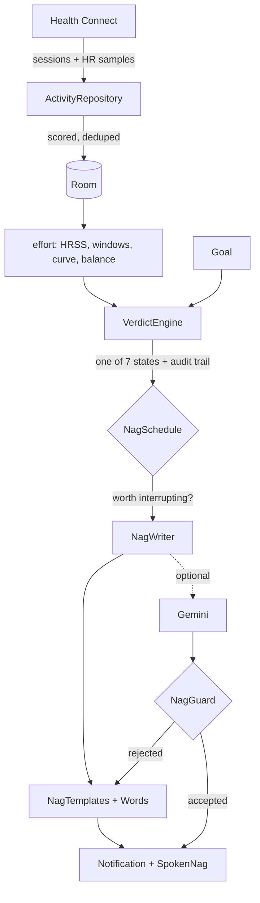

# Nagorithm, for someone reading the code for the first time

## What it is

An Android app that reads your workouts, works out whether you are actually getting anywhere, and
then tells you — in a voice you picked, on a schedule it decides, whether or not you opened it.

It is not a tracker. Garmin, Strava and Oura already record what you did and draw it as a chart,
and none of that changes anyone's behaviour, because reading a chart is a skill and caring about
one is a hobby. Nagorithm consumes that same data and emits a single opinionated paragraph. The
entire product is that paragraph. Everything upstream of it — the load model, the ratios, the
curve fitting — is infrastructure the user never sees and should never have to.

Two constraints follow from that and explain most of the design:

**It must never be confidently wrong.** One ridiculous verdict discredits every correct one that
came before it, and a nagging app you have stopped believing is an app you uninstall. So every
signal carries an explicit competence boundary, and below it the app states facts without sizing
them or says nothing at all.

**The model chooses words, never meaning.** Whether you trained enough is decided by local
arithmetic before any network call exists. An LLM is handed a settled conclusion and asked to
phrase it. It cannot promote a bad week to a good one.

v1 is local-only: no backend, no account, no cloud storage. Without an API key, health data never
leaves the device; with one, the recent sessions and notes described under "Stage three" are sent
to the user's own model provider.

---

## The pipeline

Data flows one direction and each stage knows nothing about the stage after it.



| Package | Holds |
| --- | --- |
| `health` | Health Connect reads, the sport taxonomy, the import window logic |
| `data` | Room entities, DAOs, and the repository that syncs and scores |
| `effort` | Training load, rolling windows, the fitted speed curve, efficiency, fitness/fatigue |
| `verdict` | The decision, its audit trail, template wording, and when to speak |
| `llm` | Key storage, the prompt, the Gemini call, the output guard |
| `work` | The background worker and the notification |
| `ui` | Compose screens |

`health` knows nothing about scoring. `effort` knows nothing about goals. `verdict` decides
everything the wording layer is later permitted to say. The arithmetic is all pure Kotlin with no
Android dependencies, which is why it is covered by JVM unit tests rather than by squinting at a
phone.

---

## The math

### Training load: HRSS, summed per sample

Power meters are the standard way to measure training stress and this user does not have one, and
Health Connect does not carry power anyway. That leaves heart rate. The model is Banister TRIMP,
normalised to the same 0–100-per-hour scale as power-based TSS:

```
HRr       = (HR − restingHR) / (maxHR − restingHR)      clamped to [0, 1]
TRIMP     = minutes × HRr × 0.64 × e^(1.92 × HRr)       male; 0.86 / 1.67 female
reference = TRIMP for one hour at threshold HR
HRSS      = TRIMP / reference × 100
```

One hour at threshold is 100, which means the numbers mean the same thing they mean everywhere
else in endurance sport. The exponential term is what makes load rise with roughly the square of
intensity, so easy volume correctly refuses to look like hard work.

The detail that matters: **TRIMP is summed per heart-rate sample, not applied to the session
average.** Averaging first understates variable efforts — twenty minutes hard alternating with
twenty easy averages out to something moderate — which is the exact flaw Normalized Power was
invented to fix. Health Connect's `HeartRateRecord` carries the full series, so each sample is
billed for the time until the next one.

Two guards on that summation:

- Gaps longer than **120 seconds** are clamped. Without it, a ride paused at a café bills the
  whole stop at the last heart rate seen.
- The final sample has no successor, so it inherits the median gap of the session rather than
  being dropped or billed arbitrarily.

### Sessions with no usable heart rate

Swimming forced this. Almost nobody has a swim-capable heart rate monitor, so a pool session
arrives as duration and distance only, and discarding it would tell a swimmer they did nothing —
the single worst failure available to a motivational app.

So an HR-less session is scored at an assumed **fraction of heart-rate reserve** chosen per sport:

| Sport | Assumed reserve |
| --- | --- |
| Swimming | 0.65 (zone 3 — nobody swims laps easily) |
| Running | 0.65 |
| Cycling, rowing | 0.60 |
| Walking | 0.40 |
| Other | 0.55 |

The assumption runs through the *same* TRIMP maths rather than being a flat score per hour, so it
scales with the individual's own reserve and threshold instead of asserting an absolute number
that would mean different things for different people.

**Swimming never uses sampled heart rate at all**, even when samples exist. A watch that cannot
read underwater still emits the odd stray value, and trusting those is worse than having none: on
a real device a 21-minute swim scored 5 HRSS from four stray samples, against roughly 22 for the
identical swims either side of it that had no samples to mislead the calculation.

### Partial coverage

The same failure lurks in every sport, because samples only bill the time between themselves — a
chest strap that dies halfway through a ride charges the second half at nothing. So coverage is
measured, and any stretch the samples do not span is filled at the sport's assumed intensity. Over
**90%** covered counts as measured; below that the session is flagged `PARTIAL` and says so
everywhere it appears.

### Max heart rate is asymmetric, and this is easy to get wrong

An observed peak is a **lower bound** on max HR and never an upper one. You only see a number by
actually reaching it, and an easy endurance ride proves nothing about the ceiling.

This matters more than it looks, because threshold is derived from max, so an error moves both the
session's intensity *and* the reference it is divided by. Measured on real data: dropping max from
180 to 165 inflated one ride from roughly 70 to 93. So detected max is the **higher** of the
observed peak and the age estimate, and the observed peak is itself taken as the **99th
percentile** of samples rather than the raw maximum, because one spurious spike would otherwise
define it permanently.

Resting HR is the opposite: it sits in both the session's reserve fraction and the threshold
reference, so normalisation cancels most of the error. Moving resting from 60 to 45 on the same
ride changed the score by about 7%.

### Rolling windows and ACWR

Daily HRSS feeds two flat windows: **7 days** (the acute one, "this week", the unit a person
actually feels) and **28 days** expressed per week (the personal baseline). Their ratio is the
acute-to-chronic workload ratio.

```
ACWR = 7-day total load / (28-day load ÷ 4)
```

ACWR is self-normalising, which is exactly what a model with no target needs: the same thresholds
work for someone carrying 200 a week and someone carrying 600, so a beginner is never measured
against a strong rider. Bands are `< 0.8` fading, `≤ 1.3` steady, `≤ 1.5` building, above that too
much.

It is used here for **motivation, not injury prediction** — the recent literature has been unkind
to it as a risk tool, and that critique does not apply to the use it is put to.

Two floors keep it honest, and both were added after it embarrassed itself on a real device:

- **An absolute floor of 150 HRSS in the acute window.** A ratio of small numbers is still small.
  Doubling from 60 to 120 is arithmetically alarming and physically about two hours of moderate
  work, and warning someone off at that volume is the precise opposite of what this app is for.
- **A full chronic block, meaning 28 days of history *and* at least 8 sessions in the window.**
  Short of that the denominator is not a light month, it is a month that did not exist. Three
  weeks of tracking once produced a ratio of 2.5 and told a man who had been for a bike ride to
  calm down.

### Fitness, fatigue and form

The Performance Management Chart model, computed alongside ACWR so the two can be compared on real
weeks rather than chosen from first principles. Two exponential moving averages of the same daily
load:

```
fitness += (load − fitness) / 42     CTL, barely moves
fatigue += (load − fatigue) / 7      ATL, reacts to yesterday
form     = fitness − fatigue
```

The walk covers **every** day from the first session to today, including empty ones. A rest day is
a zero, not a missing value; skipping it would leave fatigue permanently elevated because nothing
ever decayed it.

Two departures from the textbook:

**Form is reported as a percentage of the user's own fitness, not as a raw number.** The published
−10 / −30 zones were calibrated on cyclists carrying five to ten times this load. At two hours a
week, −30 raw is unreachable, and a band nobody can enter is not a band.

**It refuses to produce a number until it means something.** A 42-day average needs roughly three
of its own time constants — call it **90 days** — before it stops being mostly the zero it started
from. And if fitness is genuinely tiny, dividing by it turns an unremarkable week into a
three-figure catastrophe; a first draft reported **−296%** for a man who had gone for a bike ride.
So `formPercent` is `null` rather than a number until history has settled *and* fitness clears 5.0,
which makes it impossible for anything downstream to accidentally render a placeholder.

It also tracks what share of recent load was **estimated rather than measured**. Form is a
difference between two large numbers, so input error is amplified rather than averaged away, and
when most of the week is swims scored from an assumption the figure deserves suspicion.

### Am I getting fitter? Two models that cover each other

Load cannot answer this. Someone improving and someone grinding themselves into the ground both
post high numbers — load measures cost, not return.

**Fitted speed curve.** Over hard efforts, distance is close to linear in duration:

```
distance = criticalSpeed × time + reserve
```

Fit that line and a 900 m swim and a 1400 m swim both inform the same estimate. Nothing is
discarded for being an unusual distance, and there are no bucket boundaries to fall either side
of. It is the model behind Critical Swim Speed and functional threshold power.

An earlier version *did* bucket by distance, and it failed twice: first on boundaries — indices
from a logarithm lay down a fixed grid, so 40.0 km and 41.5 km landed either side of a line while
40.0 and 45.9 grouped happily — and then, after clustering fixed that, on the deeper problem that
bucketing can only ever speak about distances you have repeated. Real training is full of one-offs.

The fit is only honest if each point is a genuinely hard effort for its duration, which training
sessions are not, so it is fitted to the **upper envelope**: a session survives only if nothing
else covered at least as far in no more time. An easy hour is then evidence of nothing rather than
evidence of decline. Warm-ups are filtered inside the fitting function rather than by the caller,
because a single stray left in by accident bends the line badly and that is far too quiet a way to
get a wrong answer.

Guards, all of which exist because the app once got caught:

| Guard | Value | Why |
| --- | --- | --- |
| Minimum session | 600 s, and a per-sport distance floor | Warm-ups carry no threshold information |
| Duration spread | longest / shortest ≥ 1.5 | Below that, speed and reserve cannot be told apart |
| Quotable percentage | ≥ 3 points, `FITTED` quality | With two points and two parameters the line passes exactly through both and no residual remains to say whether it fits anything |
| Extrapolation | 0.7× to 1.4× of recorded distances | Outside that a straight line stops describing physiology |
| Meaningful gap | ≥ 2% | Below that it is conditions, traffic and GPS drift |
| Negative reserve | falls back to average speed | A negative intercept means the line is fitting noise |

New sessions are judged against a curve fitted **without them**, or a breakthrough would quietly
explain itself away.

Because the same line predicts a time at any distance, the abstraction converts back into
something recognisable before it reaches a human: not "critical speed rose to 0.89 m/s" but "your
1000 m is worth 18:40 now."

**Efficiency factor.** Speed per heartbeat: `(metres / seconds) / bpm`. Going faster at the same
heart rate is the cleanest evidence of aerobic improvement there is, and because both terms are
rates it does not care how long the session was. Compared as medians of the last 28 days against
the 56 before that, needing at least 10 samples and 20 minutes per session, with a **3%** bar —
higher than the curve's, because efficiency moves with heat, hills, sleep and how hard the session
was meant to be.

The pairing is the useful part, because the two want opposite things:

- **Pool swims and ergs** — a fixed, windless, flat distance every time and never any usable heart
  rate. The curve is at its best exactly where load is at its worst.
- **Road rides and runs** — reliable heart rate, distance corrupted by hills and wind. Efficiency
  carries these.

### Detraining is not a fixed clock

Someone carrying 400 HRSS a week sheds more in ten days than someone at 80, because they built
more that needs maintaining. So tolerance before absence starts costing something scales with
chronic load:

| Weekly load | Days before it counts |
| --- | --- |
| ≥ 400 | 3 |
| ≥ 250 | 4 |
| ≥ 120 | 5 |
| below | 7 |

Past that: `DRIFTING` under 10 days, `LOSING` under 21, `SOFT` beyond. Bands rather than a
percentage, because the research supports "two weeks off and you are losing it" and not a per-day
figure precise enough to quote at somebody.

---

## Turning numbers into something worth reading

This is the half that makes it a product rather than a spreadsheet, and it happens in three stages.

### Stage one: the verdict

`VerdictEngine` collapses everything above into exactly one of seven states, plus a plain-language
audit trail written at decision time.

| State | Meaning |
| --- | --- |
| `FEED_SILENT` | Health Connect returned nothing, including passive data. Not the user's fault |
| `COLD_START` | Too little history for any trend to mean anything |
| `RESTING` | Inside the recovery window for the load being carried |
| `IDLE` | Past the point where absence costs fitness |
| `STEADY` | Work going in, nothing measurably changed. The common case |
| `PROGRESSING` | Something improved in the dimension the goal cares about |
| `RAMPING_HARD` | Acute load well above what the base supports |

Three of these are worth dwelling on.

`FEED_SILENT` exists because an empty exercise list looks identical whether you rested or the sync
broke, and getting it wrong means telling someone to get off the couch two days after a sixty-mile
ride. Steps and heart rate arrive passively all day from any worn device, so if *nothing* arrived
the pipe is broken and the app says so instead of forming an opinion. This is not hypothetical — a
confirmed ride never reached Health Connect at all during testing.

`RAMPING_HARD` exists so the news case can come back negative. An engine that can only ever
congratulate is a cheerleader, and a cheerleader is not believed on the occasions it says something
true.

`STEADY` is the one that carries the app. At a cadence of every couple of days most check-ins have
no news, because fitness moves on a scale of weeks. Consistency is therefore more of the product
than the progress analysis is; the analysis is the occasional payoff.

**News is measured by when the app first saw a session, not when it happened.** Garmin can deliver
a ride days late, and a session that arrives after its window was judged is still new information
to the person who did it.

**There is no numeric target.** An absolute weekly number punishes a beginner for being a beginner
and lets a strong rider coast. The goal, written in free text, does not become a target — it
selects *which measurement becomes the baseline*, and the baseline is always the user's own earlier
value of it:

| Dimension | Goal sounds like | Measured as |
| --- | --- | --- |
| Distance | ride a century, finish a 5k | longest single effort |
| Pace | six minute mile, sub-20 5k | predicted time over a fixed distance |
| Volume | trim up, stop falling apart | 28-day load per week |

That starting value is captured once and never recomputed, or improving would move the finish line
every time it happened.

### Stage two: words instead of figures

Nothing the user reads contains a digit. Not the templates, not the model's output.

That is partly taste — a line about an acute-to-chronic ratio is neither funny nor useful, and
anyone who wants the chart already has Garmin open — and partly the only cheap answer to a problem
with no other solution, which the guard section below explains.

`Words.kt` does the conversion, and the interesting part is that the thresholds are editorial
judgements rather than roundings:

```kotlin
fun magnitude(fraction: Double): String = when {
    size < 0.02 -> "barely"        // inside the noise of a wrist sensor and a bad night's sleep
    size < 0.05 -> "slightly"
    size < 0.10 -> "noticeably"
    size < 0.20 -> "clearly"
    else        -> "dramatically"
}
```

Calling a 1% change an improvement is how an app stops being believed about the improvements that
are real. Similarly `days()` and `span()` are separate functions because "a fortnight" and "a
fortnight ago" are not interchangeable, and `weekly()` renders load as a register — very light,
light, moderate, serious, heavy — because the score itself means nothing to anyone.

`NagTemplates` composes these into a complete, shippable message for every state. This is not a
degraded fallback; it is what goes out whenever there is no API key, no signal, or a rejected
answer, and it has to read well on its own.

### Stage three: the model

The LLM is an upgrade to the voice and never a dependency. Every path out of `NagWriter` returns a
usable nag.

What the model receives:

- its **role** and the **purpose** of the message, as a stated specification
- the **voice**, written as speech mechanics rather than as a name — "clipped fragments, questions
  you do not want answered, praise that costs you something" is followed exactly, whereas naming a
  celebrity gets a vague impression at best and a refusal at worst
- the **settled verdict** and what that state means, including explicit instructions like "do not
  accuse them of anything" for a broken feed
- the **goal in the user's own words**
- `RecentPicture` — 42 days of sessions in chronological order, the same sessions regrouped by
  sport so a trend is visible, and sports not touched in 14 days
- **notes** the user has written about anything the watch cannot see, with ages attached rather
  than dates so the model never has to do date arithmetic
- the **audit trail** lines, marked explicitly as for understanding and not for quoting
- the **template** as a plain draft, for content rather than style
- the **rules**

`RecentPicture` is deliberately far more material than ever gets used, and that is the whole point.
The verdict alone is not enough to say anything interesting — "you are progressing" is a
conclusion, whereas "the swim came after the row and the lift and was still quicker than three
weeks ago" is an observation, and only the second one sounds like it was paid attention to.

The notes guidance is the only part of the prompt asking for a judgement rather than a style:
whether the subjective account and the measurements agree, and what it means when they do not.
Someone feeling stronger while their times improve has the most reliable signal there is; feeling
flat while times keep dropping is usually accumulated fatigue rather than lost fitness. It closes
with an instruction never to mock how they say they feel, because a character voice told to be
funny will otherwise use "I feel stronger" as a straight line.

### The guard, and why it got simpler

An earlier `NagGuard` verified arithmetic: every figure in the answer had to trace back to one the
verdict supplied, with tolerances for rounding. It worked, and it was the wrong shape of problem.
Verifying a model's numbers means anticipating every number it might *derive* — a pace from a
distance and a time, a percentage from two loads, a split from a total — and each new one is
another rule. The check can never be finished, only extended.

Forbidding figures altogether ends the argument. There is nothing to verify because nothing is
being claimed numerically, and the whole check collapses to:

```kotlin
private val FIGURE = Regex("""\d[\d.,:/]*""")   // catches "2:01/500m" whole
```

with one exception: digits appearing in the user's own words, so a goal of "sub-3 marathon"
survives being quoted back at them. The model is still *shown* every figure — it needs to know the
swim was seven seconds per hundred quicker in order to know the week went well — and forbidden from
printing any of them. Numbers in, words out.

A rejection is never swallowed. The template ships and the rejection is recorded in the audit
trail, because a silently substituted template is how a drifting prompt goes unnoticed.

### Why this nag?

The audit trail is written at decision time rather than reconstructed afterwards, so it shows the
inputs that were actually used and not a plausible retelling. It is also where all the exact
arithmetic still lives — the ratios, the percentages, the fitted curve quality — computed by the
app that can be held responsible for them. The figures were not deleted. They were moved out of the
message and into the place where someone who wants to argue with them can.

---

## When it speaks

`NagSchedule` is deliberately not a timer. A fixed weekly ping arrives whether or not anything
happened, which trains the user to dismiss it unread, and an app dismissed unread has failed
regardless of how good the analysis behind it was.

The rule is: speak when there is something to say, with a floor so silence never becomes permanent
and a ceiling so enthusiasm never becomes harassment.

| Rule | Value |
| --- | --- |
| Waking hours | 07:00–21:00 |
| Ceiling between nags | 20 hours (under a day, so an afternoon nag does not walk into the evening) |
| Floor when idle | 2 days — doing nothing is the case worth interrupting for |
| Floor otherwise | 7 days |
| A session arrived since it last spoke | speak now |
| Crossed from another state into idle | speak now |
| Feed silent or cold start | routine floor only — not their fault, so it is said once and left alone |

It is a pure function, because the difference between useful and obnoxious lives entirely in these
thresholds and they need to be adjustable against tests rather than against a phone over several
days.

`NagWorker` runs every 6 hours. That is not the cadence the user experiences — `NagSchedule` is —
it is just often enough that Doze deferring it costs nothing. Pressing "nag me now" bypasses the
schedule entirely, on the grounds that the rules about not being a pest do not apply to someone who
pressed the button.

---

## Storage

Room, currently **version 7**, schemas exported, with real auto-migrations from 3 onward.
Destructive migration is deliberately restricted to versions 1 and 2: past those the database holds
activity history reaching further back than Health Connect will re-serve, plus onboarding baselines
that are written once and cannot be recomputed.

| Entity | Purpose |
| --- | --- |
| `StoredActivity` | One session, keyed on Health Connect's record id so re-reads dedupe for free. Carries its load score and every input behind it, plus when the app first saw it |
| `Profile` | Age, sex, heart-rate values and overrides, onboarding baseline, last check-in, chosen voice |
| `Goal` | The text, its dimension, and the starting value that dimension is measured from. Replaced rather than edited; old goals archived, never deleted |
| `SpokenNag` | What was actually said and why, so escalation, repetition and the audit trail survive the process that produced them |
| `Note` | Free text about anything the watch cannot see, kept for 180 days |

The Gemini key is **not** in Room. It lives in `EncryptedSharedPreferences` under a hardware-backed
key, because a billable credential should not end up in a database backup.

The import watermark is not in Room either, and for a different reason: it is bookkeeping about a
fetch rather than something the user did, and it should not survive as a row that a future
migration has to reason about.

---

## Things that will surprise you

**Health Connect silently clips reads.** Without `READ_HEALTH_DATA_HISTORY`, every read is
truncated to the 30 days before permissions were granted — and it does not tell you, it just
returns fewer rows. That is not an empty history, it is a misleading one, and it is what made
fitness read low and form read catastrophic. The first sync after the grant now reaches back a
year; a watermark keeps every subsequent sync at 30 days, because reading a year of sessions means
reading a year of heart-rate samples with them and there is nothing older the second time.

**Background reads are a separate permission and easily refused.** Without
`READ_HEALTH_DATA_IN_BACKGROUND` the app can only read while open, which makes it a check-in screen
rather than a nag engine. It was granted late in development, and until then the worker had never
once read Health Connect on its own.

**Garmin does not write resting heart rate to Health Connect.** Confirmed on device: the permission
is granted and the read returns nothing. The app therefore has to treat its population default as
visibly provisional and make the override easy to find, rather than quietly scoring everything
against a number the user never supplied. This also blocks the resting-HR trend signal, which would
otherwise be nearly free and is bidirectional in a useful way — a *rising* resting heart rate
usually means fatigue or illness, which is exactly when the app should say rest rather than lazy.

**Strength training is out of scope, and that exclusion is load-bearing.** Heart rate is a poor
proxy for lifting stress, so supporting it would require a second load model with no mathematics in
common with this one. Excluding it means HRSS covers everything. Lifting reaches the app through
notes instead, as a fact rather than a measurement.

**Everything aerobic counts, always.** The first real device test settled it: 12 sessions in the
window, of which 6 were swims, 5 were rows and 1 was a ride. A cycling-only filter was discarding
ten of twelve workouts, and an engine that concludes you trained once in a month when you trained
twelve times is wrong in the most demoralising way available. Aerobic types are defined by
inversion — everything counts except an explicit non-aerobic list — so a new Health Connect
exercise type defaults to being credited rather than silently dropped. What the goal changes is
*specificity*, computed in the verdict layer: cross-training still counts, but the share of load in
the goal's sport is its own signal.

**Attribution is impossible and unnecessary.** A plateau, a taper, illness, a holiday and simple
laziness look identical from here. Two weeks off costs the same either way, because the physiology
does not care why. So the app detects the fact and lets tone carry the uncertainty rather than
diagnosing a cause it cannot see.

**Tone and truth are strictly separated.** A user who picks a gentle voice must not quietly receive
softer facts. A character may refuse to be impressed; it may not disagree about whether there was
anything to be impressed by.

---

## Testing

The load, curve, balance, verdict and schedule arithmetic is pure Kotlin, so it is all covered by
JVM unit tests:

```bash
./gradlew testDebugUnitTest
./gradlew installDebug
```

Notable cases, most of which exist because the bug shipped first: warm-ups being kept out of the
fit, a big ratio on a tiny absolute load not being a warning, a ramp not being called until the
chronic window is actually full, an unsettled average refusing to produce a number, and — the one
that catches prompt regressions — an assertion that **no template for any of the seven states
contains a digit**.

Requirements are JDK 17, Android SDK platform 36, and a physical device with Health Connect
(built in from Android 14).

---

## Known gaps

- **Cold start has no good answer yet.** Garmin only ever wrote about three weeks into Health
  Connect, so the year-long import fixed the permission but produced no extra data. Form will stay
  silent until its average burns in. The open choice is to let ACWR carry it or to let the user seed
  a starting fitness once.
- **sTSS for swims.** The fitted critical speed *is* the Functional Threshold Speed the pace-based
  TSS equation wants, which would let a hard swim outscore an easy one instead of every swim
  receiving a flat zone-3 estimate from duration.
- **Elevation is unread**, and is the largest remaining source of noise in outdoor cycling pace —
  larger than the bucketing bug ever was.
- **No way to preview wording.** The only `RESTING` message anyone will read is one that turns up on
  a day they happen to rest, and `FEED_SILENT` needs the watch to break. Iterating on the prompt
  currently takes a season.
- **Distribution.** Bring-your-own-key is the only model that needs no server. Billing users against
  a shared key is not a settings change: a key inside an APK can be unzipped out of it, so it needs
  a proxy that holds the key, authenticates users and meters calls. That is a backend, and the
  moment one exists the local-only privacy claim has to be restated honestly.
